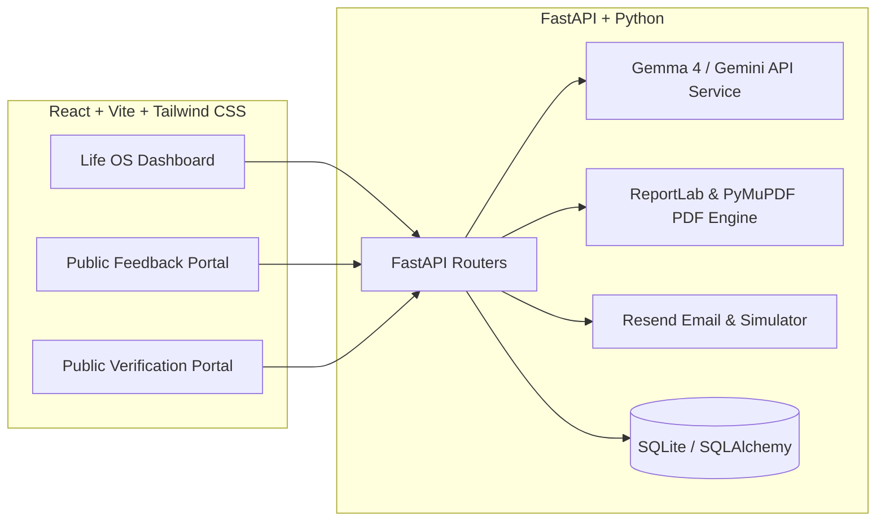

# 🌟 EventFlow AI

> **From the last session to the final certificate — automated.**

An autonomous, full-stack post-event closure and digital credentialing platform powered by **Gemma 4** and **ReportLab**. Designed for hackathons, technical conferences, webinars, workshops, and developer meetups.

---

## 🏆 MLH Hackathon Challenge Tracks

### 🌊 DigitalOcean — Best Open-Source AI Project
- **Reusable Autonomous AI Agent Skill:** Documented and packaged in [`skills/eventflow-agent/SKILL.md`](skills/eventflow-agent/SKILL.md), allowing any external AI agent (AGY, Claude, Gemini, or LangChain) to orchestrate event closure autonomously via API tools.
- **Production-Ready Deployment:** Includes multi-stage [`Dockerfile`](Dockerfile) and [`docker-compose.yml`](docker-compose.yml) optimized for single-click deployment on **DigitalOcean App Platform** or a **DigitalOcean Droplet**.
- **Permissive Open-Source Licensing:** Released under the [MIT License](LICENSE) with complete documentation, sample data, and API specifications.

### 💎 Best Use of Gemma 4
- **Event-Aware Survey Question Formulation:** Utilizes Gemma 4 through the official Google GenAI Python SDK (`google-genai`) to formulate high-yield, domain-specific feedback surveys based on event type, technical tracks, and speaker agendas.
- **Deep Qualitative & Sentiment Synthesis:** Ingests written participant feedback, comments, and ratings to calculate Net Promoter Score (NPS), generate an executive summary, cluster top praises, and identify prioritized actionable recommendations for the next edition.
- **Configurable Model Routing:** Read dynamically from the `GEMMA_MODEL_ID` environment variable or UI settings (`gemini-2.5-flash`, `gemma-2-9b-it`, `gemma-2-27b-it`, `gemini-1.5-flash`), with graceful offline fallback when no API key is supplied.

---

## ⚡ Key Features

1. **Life OS-Inspired Organizer Dashboard:** Minimalist, calm workspace with pastel indicators, rounded cards, dark charcoal typography, and a balanced two-column workflow.
2. **Flexible Participant Ingestion:** Upload CSV rosters with intelligent column auto-detection (`Name`, `Email`, `Role`, `Organization`) or add attendees manually.
3. **AI-Generated Feedback Surveys:** Gemma 4 generates 3–7 customized questions based on event metadata and custom organizer guidance.
4. **Distraction-Free Public Attendee Portal (`/feedback/:token`):** Responsive participant survey that celebrates submission with confetti and immediately unlocks verified credentials.
5. **Certificate Studio & Customizer:** 4 built-in designer themes (*Modern Minimalist*, *Tech Hackathon Matrix*, *Executive Academic Gold*, *Creative Sky*) plus custom PNG/PDF background upload.
6. **High-Resolution Vector PDF Generation:** Uses ReportLab, PyMuPDF, Pillow, and `qrcode` to generate 300 DPI print-ready certificates with dynamic QR codes, organizer signatures, and verified seals.
7. **Public Credential Verification Portal (`/verify/:cert_id`):** Real-time authenticity verification with cryptographic hashes for employers, recruiters, and attendees.
8. **Transactional Email & Interactive Simulator:** Live integration with Resend transactional email, with an Interactive Simulation Mode that logs full rendered HTML emails for inspection.
9. **One-Click Executive Closure Report:** Generates a comprehensive markdown summary report with metrics, sentiment distribution, and actionable next steps.

---

## 🏗️ Architecture & Technology Stack



- **Frontend:** React 19, TypeScript, Vite, Tailwind CSS v4, Lucide Icons, Canvas-Confetti.
- **Backend:** Python 3.10+, FastAPI, Pydantic v2, SQLAlchemy, Uvicorn.
- **AI Engine:** Google GenAI Python SDK (`google-genai`), Gemma 4 / Gemini API.
- **Document & Imaging:** ReportLab (vector PDF rendering), PyMuPDF (PDF thumbnail rendering), Pillow, `qrcode[pil]`.
- **Email:** Resend Python API + Interactive Dispatch Simulator.

---

## 🚀 Quickstart & Local Setup

### Prerequisites
- Python 3.10+
- Node.js 18+ and npm

### 1. Clone & Set Up Backend

```bash
# Clone the repository
git clone https://github.com/your-username/EventFlow-AI.git
cd EventFlow-AI

# Create Python virtual environment
python -m venv .venv
source .venv/bin/activate  # On Windows: .\.venv\Scripts\activate

# Install backend dependencies
pip install -r backend/requirements.txt

# (Optional) Set your API Keys
cp .env.example .env
# Edit .env with your GEMINI_API_KEY or RESEND_API_KEY
```

### 2. Set Up Frontend

```bash
cd frontend
npm install
```

### 3. Run Development Servers

**Terminal 1 (Backend on Port 8000):**
```bash
# From workspace root
python backend/run.py
```
*Backend will start at `http://127.0.0.1:8000` with Swagger docs at `http://127.0.0.1:8000/docs`.*

**Terminal 2 (Frontend on Port 5173):**
```bash
# From frontend directory
npm run dev
```
*Open `http://localhost:5173` in your browser.*

---

## 🐳 Docker & DigitalOcean Deployment

### Run with Docker Compose
```bash
docker-compose up --build
```
Access the application at `http://localhost:8000`.

### Deploy to DigitalOcean App Platform
1. Fork or push this repository to GitHub.
2. In DigitalOcean Console, navigate to **Apps** &rarr; **Create App**.
3. Select your GitHub repository.
4. DigitalOcean will automatically detect the `Dockerfile`.
5. Set environment variables:
   - `GEMINI_API_KEY`: Your Google GenAI API key.
   - `GEMMA_MODEL_ID`: `gemini-2.5-flash` or `gemma-2-9b-it`.
   - `RESEND_API_KEY`: Your Resend API key (optional).
   - `SIMULATION_MODE`: `false` (for live emails) or `true`.
6. Click **Deploy**!

---

## 🤖 Reusable AI Agent Skill

EventFlow AI includes a documented, open-source AI Agent Skill in [`skills/eventflow-agent/SKILL.md`](skills/eventflow-agent/SKILL.md).

External agents can automate the entire post-event workflow by invoking EventFlow API endpoints:
```bash
# 1. Generate feedback questions via Gemma 4
POST /api/events/{id}/feedback-form/generate-ai

# 2. Dispatch personalized survey tokens
POST /api/events/{id}/emails/send-feedback-invitations

# 3. Analyze participant sentiment & NPS
POST /api/events/{id}/analytics/regenerate-ai

# 4. Bulk render vector certificates with dynamic QR verification
POST /api/events/{id}/certificates/generate-all

# 5. Dispatch verified certificates to attendees
POST /api/events/{id}/emails/send-certificates
```

---

## 📄 License

This project is licensed under the [MIT License](LICENSE).
Built with ❤️ for MLH Hackathons, Google DeepMind Gemma 4, and the DigitalOcean developer community.
