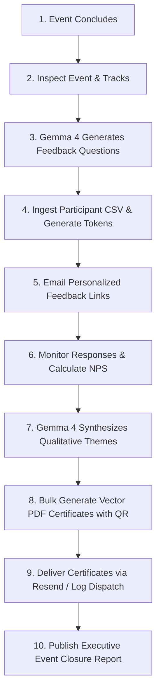

# EventFlow AI Autonomous Event Closure Skill

This skill guides an AI agent to autonomously manage the end-to-end post-event closure workflow for hackathons, technical conferences, webinars, and meetups.

## Agent Workflow Overview



## Prerequisites & Configuration

Ensure the following environment variables are available:
- `EVENTFLOW_API_URL` (default: `http://localhost:8000/api`)
- `GEMINI_API_KEY` (to enable Gemma 4 AI models)
- `GEMMA_MODEL_ID` (default: `gemini-2.5-flash` or `gemma-2-9b-it`)
- `RESEND_API_KEY` (optional; falls back to Simulation Mode if omitted)

---

## Autonomous Step-by-Step Execution Guide

### Step 1: Initialize or Retrieve the Target Event
Query the active events list:
```http
GET /api/events
```
Or create a new event record with tracks, speakers, and certificate details:
```http
POST /api/events
Content-Type: application/json

{
  "title": "Autonomous AI Summit 2026",
  "event_type": "Hackathon",
  "organization": "Open Source AI Collective",
  "date": "October 24-25, 2026",
  "location": "San Francisco, CA & Hybrid",
  "tracks": ["Agent Workflows", "Gemma 4 Innovations", "Open Infrastructure"],
  "speakers": ["Dr. Sarah Chen", "Marcus Vance"],
  "certificate_template_id": "modern_minimal",
  "signature_name": "Dr. Sarah Chen",
  "signature_title": "General Chair & Director",
  "certificate_title": "Certificate of Achievement",
  "require_feedback_for_cert": true
}
```

---

### Step 2: Generate Contextual Feedback Questions with Gemma 4
Trigger Gemma 4 to formulate targeted, high-yield questions for the specific event type and tracks:
```http
POST /api/events/{event_id}/feedback-form/generate-ai
Content-Type: application/json

{
  "event_id": "{event_id}",
  "custom_focus": "Focus deeply on mentor responsiveness, API sandbox quality, and project judging transparency",
  "target_question_count": 5
}
```

---

### Step 3: Import Participants via CSV Roster
Upload the participant directory:
```http
POST /api/events/{event_id}/participants/upload-csv
Content-Type: multipart/form-data
file=@participants.csv
```
The endpoint automatically extracts and normalizes fields: `Name`, `Email`, `Role`, `Organization`, and assigns unique cryptographically indexed `feedback_token` and `certificate_id` records.

---

### Step 4: Dispatch Unique Feedback Links
Dispatch personalized invitations:
```http
POST /api/events/{event_id}/emails/send-feedback-invitations
Content-Type: application/json

{}
```
Participants receive unique links: `https://domain.com/feedback/{feedback_token}`.

---

### Step 5: Synthesize Qualitative & Quantitative Feedback with Gemma 4
Once submissions accumulate, invoke Gemma 4 sentiment synthesis:
```http
POST /api/events/{event_id}/analytics/regenerate-ai
```
Gemma 4 analyzes written comments and numeric scores to output:
- **Net Promoter Score (NPS)** calculation
- **Positive / Neutral / Constructive Sentiment Breakdown**
- **Top 3 Highlights & Praises**
- **Critical Friction Points**
- **Prioritized Action Plan for Next Edition**

---

### Step 6: Generate Verified PDF Certificates
Bulk render vector PDF certificates featuring dynamic QR verification codes, organizer signature, and authenticity seal:
```http
POST /api/events/{event_id}/certificates/generate-all?force_all=false
```
Retrieve the packaged ZIP archive:
```http
GET /api/events/{event_id}/certificates/download-zip
```

---

### Step 7: Deliver Credentials & Verify Publicly
Dispatch completion emails with download links and verification URLs:
```http
POST /api/events/{event_id}/emails/send-certificates
Content-Type: application/json

{}
```
Anyone can verify any certificate at:
```
GET /api/public/verify/{certificate_id}
```

---

### Step 8: Produce Executive Closure Report
Export the markdown summary report for sponsors and leadership:
```http
GET /api/events/{event_id}/closure-report
```

---

## Open-Source Extension Points
- **Custom Certificate Templates:** Upload any PDF or PNG frame to `/api/events/{event_id}/certificates/upload-custom-template`.
- **DigitalOcean App Platform Deployment:** Run with single-command `docker-compose up` or containerized deployment on DO App Platform.
- **Custom LLM Routing:** Change `GEMMA_MODEL_ID` in system settings to any supported model checkpoint.
